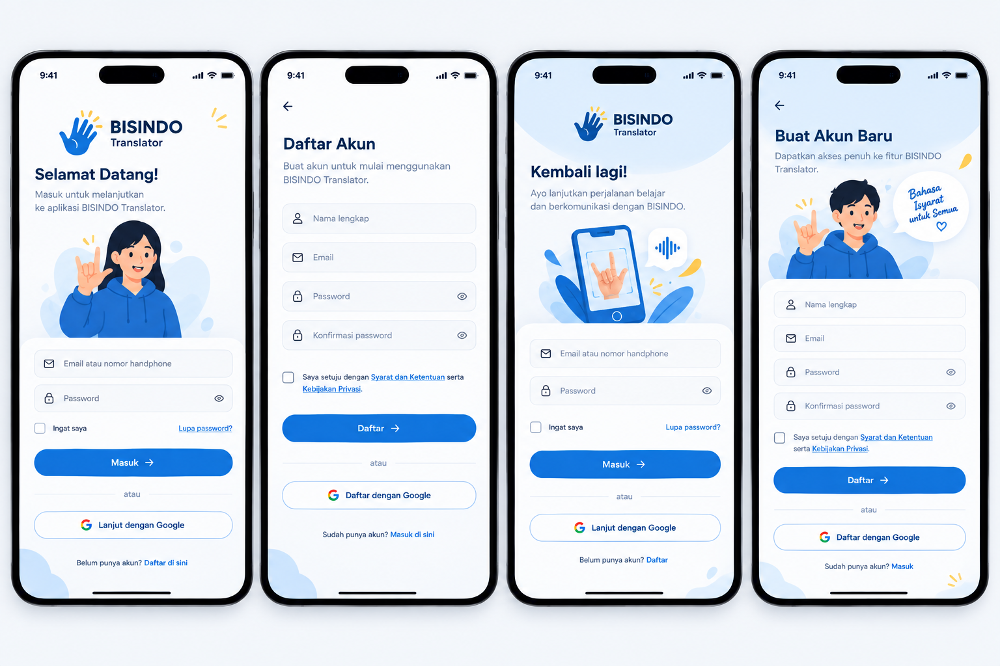

# BISINDO Translator

Aplikasi mobile untuk menerjemahkan Bahasa Isyarat Indonesia (BISINDO) secara real-time melalui kamera smartphone.

Aplikasi ini dikembangkan sebagai proyek mata kuliah (Project Based Learning) untuk memfasilitasi komunikasi bagi komunitas tunarungu.

## Status Pengembangan Proyek

Proyek ini sedang dalam tahap pengembangan aktif dengan estimasi progres keseluruhan mencapai **93%** (per 15 November 2026). Angka keseluruhan adalah rata-rata berbobot: Mobile 40%, Web 30%, Machine Learning 30%.

### Ringkasan per Komponen

| Komponen | Status | Penyelesaian | Deskripsi |
| :--- | :--- | :---: | :--- |
| Mobile (Flutter) | Dalam Pengembangan | 92% | Autentikasi (email, Google, lupa password, verifikasi email), Beranda, scan realtime dengan MediaPipe native dan TTS, Mode Belajar (latihan huruf acak dengan kamera dan skor), riwayat lokal yang tersinkron ke server, serta edit profil, foto profil, ganti password, dan hapus akun sudah berjalan. Sisa: menu Favorit (masih "segera hadir"), serta foto peragaan dan penjelasan cara memperagakan di kamus yang masih dummy. APK beta tersedia di [Releases](https://github.com/hafisc/bisindo/releases/tag/v0.9.0-beta). |
| Web Dashboard & API | Selesai | 100% | Panel admin (dashboard, pengguna, log, dataset, model) dan seluruh endpoint `/api/predict`, `/api/history`, `/api/profile`, `/api/dictionary` selesai dengan 151 test lolos. Docker dan Procfile untuk deploy sudah disiapkan. Verifikasi Firebase ID token dan deploy ke cloud dicatat sebagai pengembangan lanjutan (lihat bagian Keamanan API). |
| Machine Learning | Dalam Pengembangan | 88% | Model SVM RBF dilatih pada 127 fitur landmark untuk huruf A-Z dengan akurasi 97,91%. Evaluasi (metrik per kelas, confusion matrix 26x26, analisis huruf yang sering tertukar, perbandingan kernel) selesai dan model sudah disajikan lewat web API. Sisa: script ekstraksi landmark MediaPipe belum masuk repo (baru hasil CSV-nya), pembersihan data tidak valid, dan dokumentasi jumlah sampel per kelas. |

### Perubahan Lingkup karena Arsitektur

Dua rencana awal di issue tidak lagi dikerjakan dan tidak dihitung dalam progres:

1. **Konversi dan integrasi TFLite** (Issue #1 dan #3). Model akhir adalah SVM, yang tidak bisa dikonversi langsung ke TFLite. Prediksi dijalankan di server lewat `POST /api/predict`, mobile cukup mengirim landmark MediaPipe.
2. **Endpoint `/api/auth/register`, `/api/auth/login`, dan `/api/auth/me`** (Issue #2). Login dan register ditangani langsung oleh Firebase Auth dari aplikasi, sedangkan server mengenali pengguna dari Firebase UID.

Pengenalan kosa kata (bukan hanya huruf) dan mode offline dicatat sebagai pengembangan lanjutan.

### Pembagian Tugas dan Status Tim

| Anggota Tim | Fokus Tugas | Referensi Task | Progres |
| :--- | :--- | :--- | :---: |
| Aryaputra Ferdiananta | Modul Kamus BISINDO & Konversi Model TFLite | [Issue #1](https://github.com/hafisc/bisindo/issues/1) | 80% |
| Fadhil Taufiqurrachman | Modul Autentikasi & Pipeline Dataset MediaPipe | [Issue #2](https://github.com/hafisc/bisindo/issues/2) | 94% |
| M. Aldyth Rafiansyah Fauzi | Antarmuka Scan Kamera & Training Model Klasifikasi | [Issue #3](https://github.com/hafisc/bisindo/issues/3) | 100% |
| Mohammad Al Hafis H. | Halaman Beranda, Dashboard Admin, & Evaluasi Model | [Issue #4](https://github.com/hafisc/bisindo/issues/4) | 100% |
| Mokhamad Rizki Hadiono S. | Riwayat Deteksi, Manajemen Profil, & Pengumpulan Data | [Issue #5](https://github.com/hafisc/bisindo/issues/5) | 91% |

Progres per anggota dihitung dari checklist di issue masing-masing: jumlah item yang selesai dibagi jumlah item, dengan item yang baru sebagian selesai dihitung setengah. Item yang keluar dari lingkup (lihat bagian sebelumnya) tidak ikut dihitung.

| Anggota | Item selesai | Sisa pekerjaan |
| :--- | :---: | :--- |
| Aryaputra | 4 dari 5 | Foto atau ilustrasi peragaan tiap huruf, penjelasan cara memperagakan yang masih teks dummy |
| Fadhil | 7,5 dari 8 | Script ekstraksi MediaPipe dari foto mentah belum masuk repo |
| Aldyth | 9 dari 9 | Tidak ada. Mode Belajar dikerjakan di luar lingkup issue |
| Hafis | 11 dari 11 | Tidak ada. APK release dirilis sebagai [v0.9.0-beta](https://github.com/hafisc/bisindo/releases/tag/v0.9.0-beta) |
| Rizki | 14,5 dari 16 | Pembersihan data tidak valid, dokumentasi jumlah sampel per kelas |

## Daftar Fitur

- Scanner Real-time: Mendeteksi gestur tangan dan menerjemahkannya secara langsung.
- Text-to-Speech: Mengubah hasil deteksi teks menjadi output suara.
- Kamus BISINDO: Daftar referensi peragaan abjad (A-Z) dan kosa kata umum.
- Mode Belajar: Fasilitas latihan mandiri dengan umpan balik langsung.
- Riwayat Terjemahan: Menyimpan log hasil terjemahan sebelumnya.
- Manajemen Akun: Pendaftaran dan pengaturan profil pengguna.

## Preview Aplikasi

- Onboarding
  
- Login & Register
  

## Struktur Repositori

Proyek ini menggunakan struktur monorepo yang memisahkan bagian mobile, machine learning, dan web:

- `mobile/`: Berisi kode sumber aplikasi berbasis Flutter.
- `ml/`: Berisi pipeline Machine Learning menggunakan Python (dataset, notebook, script training).
- `design/`: Berisi aset desain dan mockup aplikasi.
- `web/`: Berisi kode sumber dashboard admin menggunakan Flask.

## Teknologi yang Digunakan

Aplikasi Mobile:
- Framework: Flutter 3.32 (Dart 3.8)
- State Management: Riverpod + Equatable
- Routing: GoRouter
- Dependency Injection: GetIt + Injectable
- Layanan Cloud: Firebase (Auth, Firestore, Storage)
- Local Database: Hive
- Text-to-Speech: flutter_tts

Machine Learning:
- Bahasa: Python 3.12
- Model: SVM kernel RBF (scikit-learn), 127 fitur landmark
- Akurasi data uji: 97,91%
- Ekstraksi Fitur: MediaPipe
- Inferensi: di server Flask lewat `POST /api/predict` (mobile mengirim landmark MediaPipe)

Web Dashboard:
- Framework: Flask (Python)

## REST API (Web)

Server Flask menyediakan endpoint JSON untuk aplikasi mobile. Semua endpoint
riwayat memakai header `X-User-Id` berisi Firebase UID pengguna yang sudah
login. Sebagai alternatif, UID boleh dikirim lewat query string `user_id` atau
field `user_id` di body JSON.

| Method | Endpoint | Keterangan |
| :--- | :--- | :--- |
| GET | `/api/status` | Status layanan dan kesiapan model prediksi |
| GET | `/api/model` | Informasi model aktif: jumlah fitur, daftar kelas, akurasi |
| POST | `/api/predict` | Prediksi huruf BISINDO dari 21 atau 42 titik landmark tangan |
| GET | `/api/dictionary` | Daftar seluruh huruf kamus BISINDO |
| GET | `/api/dictionary/<huruf>` | Detail satu huruf kamus |
| GET | `/api/history` | Riwayat deteksi milik pengguna, terbaru lebih dulu |
| POST | `/api/history` | Simpan satu entri riwayat baru |
| DELETE | `/api/history/<id>` | Hapus satu entri riwayat |
| DELETE | `/api/history` | Hapus seluruh riwayat pengguna |
| GET | `/api/profile` | Ambil profil pengguna |
| PUT | `/api/profile` | Buat atau perbarui profil pengguna |

Contoh prediksi satu tangan:

```bash
curl -X POST http://127.0.0.1:5000/api/predict \
  -H "Content-Type: application/json" \
  -d '{"landmarks": [{"x": 0.1, "y": 0.2, "z": 0.0}, "... 21 titik"]}'
```

Respons berisi `prediction`, `confidence`, `class_index`, `hand_order`, dan
`mirrored`. Model memakai 127 fitur, tetapi server yang menyusunnya: kirim 21
titik untuk satu tangan atau 42 titik untuk dua tangan. Bila hanya 21 titik yang
dikirim, 63 nilai tangan kedua diisi nol dan `is_two_handed` bernilai 0.

Server melakukan dua normalisasi yang wajib, sama seperti saat dataset latih
dibuat: mengurangi posisi pergelangan tangan pertama, lalu membagi dengan jarak
pergelangan ke titik 9 (pangkal jari tengah). Landmark mentah MediaPipe boleh
dikirim apa adanya dalam koordinat gambar 0-1.

Ada dua ketidakpastian yang tidak bisa diketahui server, jadi keduanya diuji
sebagai kandidat lalu dipilih hasil dengan confidence tertinggi:

1. **Urutan tangan.** MediaPipe mengembalikan tangan sesuai urutan deteksi,
   sedangkan dataset latih selalu menaruh tangan pertama di kolom awal. Tanpa
   penanganan ini, akurasi dua tangan jatuh dari 99,58% menjadi 9,92%. Nilai
   `hand_order` berisi `as_is` atau `swapped`.
2. **Pencerminan.** Kamera depan dan konvensi koordinat berbeda antar perangkat.
   Tanpa kandidat cermin, data yang tercermin hanya dikenali 51,34%. Dengan
   kandidat cermin, akurasi kembali di atas 96%. Nilai `mirrored` berisi `true`
   bila kandidat cermin yang menang.

Total ada empat kandidat untuk dua tangan (dua urutan dikali dua cermin) dan dua
kandidat untuk satu tangan. Biaya tambahannya kecil: satu permintaan prediksi
selesai sekitar 2 sampai 3 ms di laptop pengembangan.

Contoh menyimpan riwayat:

```bash
curl -X POST http://127.0.0.1:5000/api/history \
  -H "Content-Type: application/json" \
  -H "X-User-Id: <firebase-uid>" \
  -d '{
    "title": "Halo",
    "type": "Kata",
    "category": "Teks",
    "mode": "BISINDO -> Teks",
    "confidence": 0.95,
    "timestamp": "2026-11-11T10:20:00"
  }'
```

Nilai `type` yang diterima adalah `Kata` atau `Huruf`, sedangkan `category`
adalah `Teks` atau `Suara`. Field `confidence` harus di antara 0.0 dan 1.0.
Field `timestamp` bersifat opsional; bila kosong, server memakai waktu saat
request diterima.

Contoh sinkronisasi profil setelah login:

```bash
curl -X PUT http://127.0.0.1:5000/api/profile \
  -H "Content-Type: application/json" \
  -H "X-User-Id: <firebase-uid>" \
  -d '{
    "name": "Budi Santoso",
    "email": "budi@mail.com",
    "student_id": "2210512001",
    "role": "Mahasiswa"
  }'
```

`PUT /api/profile` bersifat upsert: panggilan pertama membuat baris pengguna
dan membalas 201, panggilan berikutnya memperbarui field yang dikirim saja dan
membalas 200. Field `name` dan `email` wajib pada panggilan pertama. Mengirim
string kosong pada `student_id`, `role`, atau `avatar_url` akan mengosongkan
nilai tersebut.

### Keamanan API

Endpoint riwayat dan profil memakai header `X-User-Id` yang belum diverifikasi
tanda tangannya, begitu juga `user_id` pada body `/api/predict`. Artinya siapa
pun yang mengetahui UID seseorang bisa membaca riwayatnya. Untuk demo lokal hal
ini masih bisa diterima, tetapi sebelum server dipasang di internet sebaiknya
diganti dengan verifikasi Firebase ID token memakai `firebase-admin`: mobile
mengirim `Authorization: Bearer <id-token>`, server memverifikasinya lalu
mengambil UID dari token tersebut.

### Menjalankan test web

```bash
cd web/
python -m venv .venv
.venv\Scripts\activate
pip install -r requirements-dev.txt
pytest
```

### Menjalankan server secara lokal

```bash
cd web/
.venv\Scripts\activate
python run.py
```

Server berjalan di `http://127.0.0.1:5000`. Model SVM dimuat dari
`ml/models/svm_rbf_bisindo.joblib`. Bila path berbeda, atur lewat variabel
lingkungan `MODEL_PATH`.

### Panel admin

Halaman admin tersedia di `/admin` setelah login memakai `ADMIN_USERNAME` dan
`ADMIN_PASSWORD`. Selain dashboard, pengguna, dan log deteksi, ada dua halaman
untuk mengelola berkas:

| Halaman | Endpoint | Keterangan |
| :--- | :--- | :--- |
| Dataset | `GET /admin/dataset` | Daftar snapshot CSV, statistik baris dan kelas, peringatan nama berkas lintas kelas |
| Unggah dataset | `POST /admin/dataset/upload` | Simpan CSV landmark 127 kolom, tolak kolom kurang atau berkas ganda |
| Model | `GET /admin/model` | Daftar versi model dan ringkasan model yang sedang dilayani server |
| Unggah model | `POST /admin/model/upload` | Simpan `.joblib` beserta `label_map.json` dan `metrics.json` opsional |

Berkas unggahan disimpan di `web/instance/datasets/` dan `web/instance/models/`
sehingga tidak masuk git. Server menolak model yang jumlah fiturnya bukan 127
atau tidak memiliki `predict_proba`.

Mengaktifkan versi model langsung memuat ulang model pada proses yang berjalan
(`services.reload_model()`), dan pilihan itu dipulihkan otomatis saat server
dijalankan ulang. Model aktif tidak bisa dihapus sebelum ada versi lain yang
diaktifkan.

Pelatihan tetap dijalankan dari terminal, bukan dari panel admin, karena
melatih SVM memblokir request Flask:

```bash
python ml/src/training/train_svm.py --csv data/landmarks.csv
```

Setelah artefak jadi, unggah `svm_rbf_bisindo.joblib` di halaman Model lalu
tekan Aktifkan.

### Deploy ke cloud

Repositori sudah menyiapkan dua jalur deploy yang portabel, tidak terikat satu
penyedia.

Docker:

```bash
docker build -t bisindo-api .
docker run -p 8000:8000 bisindo-api
```

`Procfile` dipakai platform yang menjalankan perintah `web:` seperti Heroku atau
Render. Keduanya menjalankan `gunicorn` dengan aplikasi `web/run.py` memakai
satu worker, supaya model yang diaktifkan lewat panel admin konsisten di semua
request.

Model tidak dilatih di dalam image. Alur yang benar: latih lewat CLI
(`python ml/src/training/train_svm.py`), lalu deploy artefaknya. Training di
dalam request Flask akan memblokir server.

Catatan ukuran: karena tidak lagi memakai TensorFlow, image hanya berisi Flask,
NumPy, scikit-learn, dan joblib. Tanpa TensorFlow, image jauh lebih kecil dan
server mulai di bawah satu detik.

#### Data yang harus bertahan

Filesystem container cloud dibuang setiap redeploy. Ada dua hal yang harus
disiapkan agar riwayat dan unggahan tidak hilang:

1. **Database.** Isi `DATABASE_URL` dengan connection string Postgres, misalnya
   dari add-on database penyedia. `postgres://` otomatis dinormalkan menjadi
   `postgresql://`. Tanpa itu server memakai SQLite di dalam container, dan
   seluruh riwayat hilang saat redeploy.
2. **Folder unggahan.** Dataset dan model dari panel admin disimpan di
   `web/instance`. Arahkan env `INSTANCE_DIR` ke folder volume persisten, atau
   pasang volume ke `/app/web/instance`.

Isi juga `SECRET_KEY` dan `ADMIN_PASSWORD` dengan nilai acak. Nilai bawaan di
`web/app/config.py` hanya untuk pengembangan lokal.

#### Alamat server di aplikasi mobile

Aplikasi mobile tidak menyimpan alamat server di dalam kode. Ada dua cara
mengaturnya:

- **Saat build**, lewat `--dart-define`:

  ```bash
  flutter run -d <id-hp> --dart-define=API_BASE_URL=http://127.0.0.1:5000
  ```

- **Saat aplikasi berjalan**, lewat ikon gerigi di kanan atas layar Scan. Cara
  ini tidak butuh build ulang, jadi teman yang memakai laptop berbeda cukup
  mengganti alamat di sana.

Alamat bawaan adalah `http://127.0.0.1:5000`, yaitu jalur kabel USB:

```bash
adb reverse tcp:5000 tcp:5000
flutter run -d <id-hp>
```

`adb reverse` meneruskan port 5000 di HP ke port 5000 di laptop, sehingga
Windows Firewall tidak ikut campur. Perintah itu perlu diulang setiap kabel
dicabut atau HP di-reboot. Alamat ini tidak memakai alias emulator `10.0.2.2`,
karena emulator x86_64 tidak punya MediaPipe native sehingga kamera tidak bisa
diuji di sana.

Untuk demo di WiFi yang sama, jalankan `python web/run.py`. Server mencetak
alamat `http://<ip-laptop>:5000` yang bisa langsung diisi di layar Scan.

Catatan HTTP polos: semua build type, termasuk release, mengizinkan HTTP polos
lewat `android/app/src/main/res/xml/network_security_config.xml`, karena server
demo berjalan di laptop tanpa HTTPS. Firebase tetap memakai HTTPS. Setelah
server di-deploy dengan HTTPS, ubah `cleartextTrafficPermitted` di file itu
menjadi `false`.

## Panduan Instalasi dan Penggunaan

### Persyaratan Sistem
- Flutter SDK (Minimal versi 3.32)
- Dart SDK (Minimal versi 3.8)
- Python (Minimal versi 3.10)
- Android Studio atau VSCode
- Git

### 1. Clone Repositori
```bash
git clone https://github.com/hafisc/bisindo.git
cd bisindo
```

### 2. Konfigurasi Firebase (Wajib)
Langkah ini diperlukan agar aplikasi dapat berjalan dengan normal:
1. Buat proyek baru bernama `bisindo-translator` di Firebase Console.
2. Tambahkan aplikasi Android dengan package name `com.bisindo.bisindo_translator`.
3. Unduh file `google-services.json` dan letakkan di dalam direktori `mobile/android/app/`.
4. Aktifkan layanan Authentication (Email/Password & Google Sign-In) dan Firestore Database.

### 3. Menjalankan Aplikasi Mobile
```bash
cd mobile/
flutter pub get
dart run build_runner build --delete-conflicting-outputs
flutter run
```

### Build APK Release

APK release ditandatangani dengan keystore milik tim, bukan kunci debug.
Keystore dan password-nya tidak masuk repo. Minta file `.jks` dan isi
`key.properties` ke anggota yang memegangnya.

1. Simpan keystore di luar folder repo, misalnya
   `C:\Users\<nama>\keystores\bisindo-release.jks`.
2. Buat `mobile/android/key.properties` (sudah di-ignore git):

   ```properties
   storePassword=<password>
   keyPassword=<password>
   keyAlias=bisindo
   storeFile=C:/Users/<nama>/keystores/bisindo-release.jks
   ```

3. Build:

   ```bash
   cd mobile/
   flutter build apk --release
   ```

   Hasilnya ada di `mobile/build/app/outputs/flutter-apk/app-release.apk`. Bila
   `key.properties` tidak ada, Gradle memakai kunci debug sebagai cadangan dan
   APK tersebut tidak boleh dirilis.

Login Google di APK release hanya berjalan bila SHA-1 keystore release sudah
didaftarkan di Firebase Console (Project settings, aplikasi Android, Add
fingerprint), lalu `google-services.json` diunduh ulang. Ambil SHA-1 dengan:

```bash
keytool -list -v -keystore <path-keystore> -alias bisindo
```

Build release memakai R8 (`isMinifyEnabled = true`). Aturan keep untuk
MediaPipe ada di `mobile/android/app/proguard-rules.pro`; tanpa aturan itu
layar Scan crash karena nama kelas MediaPipe yang dipanggil dari kode native
ikut diubah.

### 4. Konfigurasi Environment Machine Learning
```bash
cd ml/
python -m venv .venv
.venv\Scripts\activate
pip install -r requirements.txt
```

## Alur Navigasi Aplikasi

1. Splash Screen
2. Onboarding (Hanya muncul saat pertama kali dibuka)
3. Login / Register
4. Halaman Utama (Beranda)
   - Menu Scanner
   - Menu Kamus
   - Menu Riwayat
   - Menu Profil

## Pipeline Machine Learning

Alur kerja pelatihan model hingga siap digunakan di aplikasi:
1. `ml/src/dataset/data_loader.py`: Membaca CSV landmark, menyusun 127 fitur, lalu membagi data latih dan uji.
2. `ml/src/training/train_svm.py`: Melatih SVM RBF dan menyimpan `svm_rbf_bisindo.joblib`, `label_map.json`, serta `metrics.json`.
3. `ml/src/evaluation/evaluate_svm.py`: Menghitung akurasi, confusion matrix, F1 per kelas, dan membandingkan kernel linear, polynomial, dan RBF.
4. `ml/tests/test_svm.py`: Memastikan susunan fitur, pemuatan dataset, dan artefak model tetap konsisten.

Detail lengkap ada di [`ml/README.md`](ml/README.md).

## Daftar Perintah Penting

Perintah Flutter:
```bash
flutter pub get
dart run build_runner build --delete-conflicting-outputs
flutter analyze
flutter test
flutter build apk --release
```

Perintah Python (ML):
```bash
pip install -r ml/requirements.txt
python ml/src/training/train_svm.py
python ml/src/evaluation/evaluate_svm.py --compare
python -m pytest ml/tests -q
```
