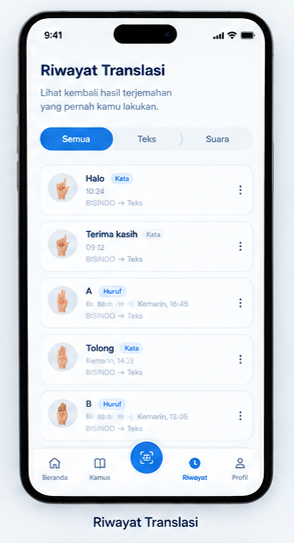
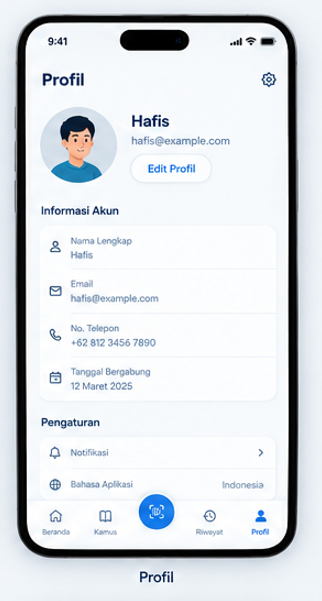
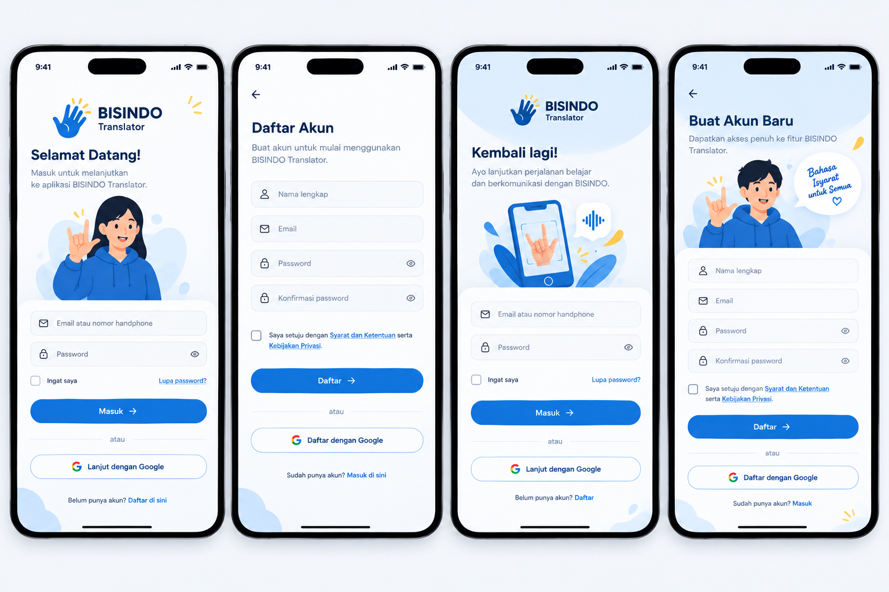
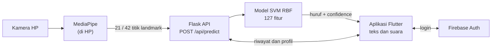

<div align="center">


**Penerjemah Bahasa Isyarat Indonesia (BISINDO) secara real-time lewat kamera smartphone**

[](https://flutter.dev)
[](https://flask.palletsprojects.com)
[](ml/README.md)
[](https://firebase.google.com)
[](https://github.com/hafisc/bisindo/releases)

Proyek Project Based Learning semester 5 untuk membantu komunikasi dengan teman tuli.

[Fitur](#fitur) · [Arsitektur](#arsitektur) · [Menjalankan Proyek](#menjalankan-proyek) · [Model](#model-machine-learning) · [Tim](#tim-dan-progres)

</div>

---

## Fitur

| Fitur | Keterangan |
| :--- | :--- |
| **Scan real-time** | Kamera mendeteksi tangan dengan MediaPipe, lalu huruf A-Z ditebak oleh model SVM dan dibacakan dengan Text-to-Speech |
| **Mode Belajar** | Latihan huruf acak dengan kamera dan skor |
| **Kamus BISINDO** | Ilustrasi peragaan huruf A-Z dari sampel asli dataset, panduan cara memperagakan, dan perbandingan dengan huruf yang sering tertukar |
| **Favorit** | Simpan huruf atau kata yang sering dilatih |
| **Riwayat** | Hasil terjemahan tersimpan dan tersinkron ke server |
| **Akun** | Daftar dan login (email atau Google), verifikasi email, lupa password, edit profil, ganti password, hapus akun |
| **Panel Admin (web)** | Dashboard, data pengguna, log deteksi, kelola dataset dan versi model |

## Tampilan

<table>
  <tr>
    <td align="center"></td>
    <td align="center"></td>
    <td align="center"></td>
  </tr>
</table>

<details>
<summary>Onboarding, login, dan register</summary>
<br>




</details>

## Arsitektur



Gambar kamera tidak pernah dikirim. HP hanya mengirim koordinat titik tangan, lalu server menormalkan koordinat itu dan menjalankan model. Model SVM tidak bisa dikonversi ke TFLite, jadi prediksi dijalankan di server.

## Teknologi

| Bagian | Teknologi |
| :--- | :--- |
| Mobile | Flutter 3.32 (Dart 3.8), Riverpod, GoRouter, GetIt + Injectable, MediaPipe Hand Landmarker, flutter_tts, sqflite, SharedPreferences |
| Backend | Flask, SQLAlchemy (SQLite atau Postgres), Gunicorn, Docker |
| Machine Learning | Python, scikit-learn (SVM RBF), MediaPipe, pandas |
| Layanan | Firebase Auth, Firestore, Storage |

## Struktur Repositori

```
bisindo/
├── mobile/    Aplikasi Flutter, lihat mobile/README.md
├── web/       Server Flask: REST API dan panel admin, lihat web/README.md
├── ml/        Dataset, training, evaluasi model, lihat ml/README.md
└── design/    Mockup tampilan aplikasi
```

## Menjalankan Proyek

**Persyaratan:** Flutter 3.32 atau lebih baru, Python 3.10 atau lebih baru, Android Studio atau VS Code, dan HP Android asli. Emulator tidak bisa menjalankan MediaPipe.

### 1. Clone

```bash
git clone https://github.com/hafisc/bisindo.git
cd bisindo
```

### 2. Jalankan server

```bash
cd web
python -m venv .venv
.venv\Scripts\activate
pip install -r requirements.txt
python run.py
```

Server berjalan di `http://127.0.0.1:5000`, dan panel admin ada di `/admin`. Model dimuat otomatis dari `ml/models/svm_rbf_bisindo.joblib`.

### 3. Jalankan aplikasi

Letakkan `google-services.json` dari Firebase Console (package `com.bisindo.bisindo_translator`) di `mobile/android/app/`. Setelah itu, sambungkan HP lewat USB:

```bash
cd mobile
flutter pub get
dart run build_runner build --delete-conflicting-outputs
adb reverse tcp:5000 tcp:5000
flutter run
```

`adb reverse` menghubungkan HP ke server di laptop. Untuk koneksi lewat WiFi, isi alamat yang dicetak `run.py` di ikon gerigi pada layar Scan. Cara build APK release ada di [mobile/README.md](mobile/README.md).

### 4. Menjalankan test

| Bagian | Dari folder | Perintah | Jumlah test |
| :--- | :--- | :--- | :---: |
| Mobile | `mobile/` | `flutter analyze` lalu `flutter test` | 68 |
| Web | `web/` | `pip install -r requirements-dev.txt` lalu `pytest` | 151 |
| ML | akar repo | `pip install -r ml/requirements.txt` lalu `python -m pytest ml/tests -q` | 27 |

## Model Machine Learning

| | |
| :--- | :--- |
| Model | SVM kernel RBF (`C=10`, `gamma='scale'`) |
| Fitur | 127: 21 titik x 3 koordinat untuk tiap tangan (dua tangan), ditambah penanda dua tangan |
| Dataset | 6.733 baris setelah 1.160 baris duplikat dibuang |
| Akurasi data uji | **96,36%** (macro F1 0,96) |
| Huruf terlemah | Y dan B, F1 sekitar 0,89 sampai 0,90 |

Alur pipeline, tabel jumlah sampel tiap huruf, dan cara melatih ulang model ada di [ml/README.md](ml/README.md).

## Tim dan Progres

Seluruh tugas di Issue #1 sampai #5 sudah selesai (**100%**, per 15 November 2026).

| Anggota | Tugas | Issue | Progres |
| :--- | :--- | :---: | :---: |
| Aryaputra Ferdiananta | Modul Kamus BISINDO | [#1](https://github.com/hafisc/bisindo/issues/1) | 100% |
| Fadhil Taufiqurrachman | Autentikasi dan pipeline dataset MediaPipe | [#2](https://github.com/hafisc/bisindo/issues/2) | 100% |
| M. Aldyth Rafiansyah Fauzi | Scan kamera dan training model | [#3](https://github.com/hafisc/bisindo/issues/3) | 100% |
| Mohammad Al Hafis H. | Beranda, dashboard admin, dan evaluasi model | [#4](https://github.com/hafisc/bisindo/issues/4) | 100% |
| Mokhamad Rizki Hadiono S. | Riwayat, profil, dan pengumpulan data | [#5](https://github.com/hafisc/bisindo/issues/5) | 100% |

**Di luar lingkup.** Dua rencana di issue tidak dikerjakan dan tidak ikut dihitung dalam progres:

- **Konversi model ke TFLite:** model SVM tidak bisa dikonversi, jadi prediksi dijalankan di server.
- **Endpoint `/api/auth/*`:** login sudah ditangani Firebase Auth.

**Pengembangan lanjutan:** pengenalan kosa kata, mode offline, verifikasi Firebase ID token di server, dan deploy ke cloud.

### Sebelum demo

- [ ] Daftarkan SHA-1 keystore release dan SHA-1 debug tiap laptop di Firebase Console agar login Google berjalan
- [ ] Uji Scan dan Mode Belajar di HP asli
- [ ] Pastikan HP dan laptop terhubung (`adb reverse` atau WiFi yang sama)
