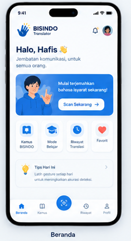
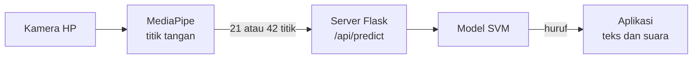

<div align="center">

<picture>
  <source media="(prefers-color-scheme: dark)" srcset="design/logo-dark.png">
  
</picture>

<h3>Penerjemah Bahasa Isyarat Indonesia secara real-time lewat kamera HP</h3>

[](mobile/README.md)
[](web/README.md)
[](ml/README.md)
[](https://firebase.google.com)
[](https://github.com/hafisc/bisindo/releases)

Project Based Learning Semester 5, Kelompok 1

[Fitur](#fitur) &nbsp;·&nbsp; [Cara Kerja](#cara-kerja) &nbsp;·&nbsp; [Menjalankan](#menjalankan) &nbsp;·&nbsp; [Dokumentasi](#dokumentasi) &nbsp;·&nbsp; [Tim](#tim)

<br>

<table>
  <tr>
    <td align="center"><br><sub><b>Beranda</b></sub></td>
    <td align="center"><br><sub><b>Riwayat</b></sub></td>
    <td align="center"><br><sub><b>Profil</b></sub></td>
  </tr>
</table>

</div>

## Tentang

Banyak orang ingin berkomunikasi dengan teman tuli tetapi belum menguasai bahasa isyarat. BISINDO Translator mengenali huruf BISINDO yang diperagakan di depan kamera, lalu menampilkannya sebagai teks dan membacakannya dengan suara. Aplikasi ini juga menyediakan kamus dan mode belajar untuk berlatih.

## Fitur

| Fitur | Fungsi |
| :--- | :--- |
| **Scan real-time** | Mengenali huruf A-Z dari kamera, lalu menampilkan dan membacakannya |
| **Mode Belajar** | Latihan memperagakan huruf acak dengan skor |
| **Kamus** | Ilustrasi huruf A-Z yang diambil dari peragaan asli di dataset |
| **Favorit** | Menyimpan huruf yang sering dilatih |
| **Riwayat** | Hasil terjemahan tersimpan per akun dan tersinkron ke server |
| **Akun** | Login email atau Google, verifikasi email, edit profil dan foto |
| **Panel Admin** | Web untuk mengelola pengguna, log deteksi, dataset, dan versi model |

## Cara Kerja



HP hanya mengirim koordinat titik tangan, bukan gambar kamera. Server menormalkan koordinat menjadi 127 fitur, lalu model SVM (kernel RBF) menebak hurufnya. Model dilatih dengan 6.733 sampel dan mencapai **akurasi 96,36%** pada data uji.

| Bagian | Teknologi |
| :--- | :--- |
| Mobile | Flutter, Riverpod, GoRouter, MediaPipe Hand Landmarker, SQLite |
| Backend | Flask, SQLAlchemy, Gunicorn, Docker |
| Machine Learning | Python, scikit-learn, MediaPipe, pandas |
| Layanan | Firebase Auth dan Firestore |

## Menjalankan

Butuh Flutter 3.32 atau lebih baru, Python 3.10 atau lebih baru, dan HP Android asli. Emulator tidak bisa menjalankan MediaPipe.

**1. Jalankan server** dari folder `web/`

```bash
pip install -r requirements.txt
python run.py
```

**2. Jalankan aplikasi** dari folder `mobile/`, dengan HP tersambung lewat USB dan `google-services.json` sudah ada di `mobile/android/app/`

```bash
flutter pub get
dart run build_runner build --delete-conflicting-outputs
adb reverse tcp:5000 tcp:5000
flutter run
```

Pengaturan lain seperti koneksi lewat WiFi, build APK release, dan deploy server ada di [Dokumentasi](#dokumentasi).

## Struktur Repositori

```
bisindo/
├── mobile/   Aplikasi Flutter
├── web/      Server Flask: REST API dan panel admin
├── ml/       Dataset, training, dan evaluasi model
└── design/   Mockup tampilan dan logo
```

## Dokumentasi

| Dokumen | Isi |
| :--- | :--- |
| [mobile/README.md](mobile/README.md) | Struktur kode, alamat server, Firestore, build APK release |
| [web/README.md](web/README.md) | Daftar endpoint API, panel admin, variabel lingkungan, deploy |
| [ml/README.md](ml/README.md) | Dataset, pipeline training, hasil evaluasi model |

Pengujian otomatis: 85 test mobile (`flutter test`), 151 test web (`pytest`), dan 27 test ML.

## Tim

| Anggota | Peran |
| :--- | :--- |
| Aryaputra Ferdiananta | Kamus BISINDO |
| Fadhil Taufiqurrachman | Autentikasi dan pipeline dataset |
| M. Aldyth Rafiansyah Fauzi | Scan kamera dan training model |
| Mohammad Al Hafis H. | Beranda, panel admin, dan evaluasi model |
| Mokhamad Rizki Hadiono S. | Riwayat, profil, dan pengumpulan data |
