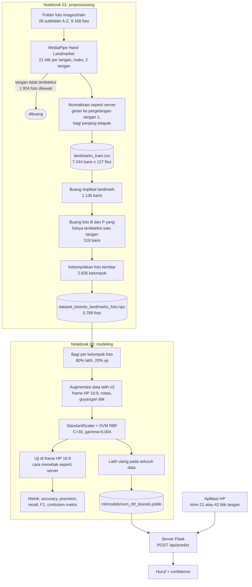
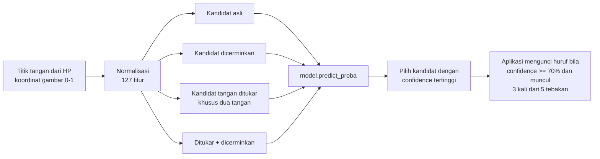

# ML Pipeline BISINDO

Pipeline pelatihan model klasifikasi huruf BISINDO A-Z dari koordinat titik
tangan MediaPipe. Model yang dipakai server adalah **SVM kernel RBF**
(`ml/models/svm_rbf_bisindo.joblib`), dilatih dari foto di folder
`images/train` dan disesuaikan dengan kondisi kamera HP.

## Alur dari foto sampai model



Langkah demi langkah:

**Notebook 01: preprocessing** (`01_preprocessing_dataset_foto.ipynb`)

1. **Kumpulkan foto.** Foto disusun dalam 26 subfolder A-Z di `images/train`,
   total 9.168 foto. Nama folder menjadi label hurufnya.
2. **Ekstraksi fitur dengan MediaPipe.** Setiap foto dibaca MediaPipe Hand
   Landmarker (model yang sama dengan aplikasi Android). Hasilnya 21 titik
   (x, y, z) untuk setiap tangan, maksimal dua tangan. Pada 1.924 foto tangan
   tidak terdeteksi, jadi foto itu dilewati.
3. **Normalisasi.** Tangan dengan pergelangan paling kiri menjadi tangan 1.
   Semua titik digeser supaya pergelangan tangan 1 berada di titik nol, lalu
   dibagi panjang telapak tangan 1. Dengan begitu posisi dan ukuran tangan di
   foto tidak berpengaruh. Hasilnya 127 fitur per foto, disimpan ke
   `landmarks_train.csv` (7.244 baris).
4. **Buang duplikat.** 1.136 baris yang titiknya sama persis dengan baris lain
   dibuang.
5. **Buang foto B dan P yang hanya terdeteksi satu tangan.** B dan P dibentuk
   dengan dua tangan. Bila hanya satu tangan tertangkap, separuh B mirip E dan
   separuh P mirip D, sehingga 319 baris ini dibuang supaya model tidak salah
   belajar.
6. **Kelompokkan foto kembar.** Foto yang bentuk tangannya nyaris sama
   (jepretan beruntun atau hasil augmentasi gambar) diberi nomor kelompok yang
   sama. Hasilnya 2.826 kelompok dari 5.789 foto.
7. **Simpan NPZ.** Data bersih beserta nomor kelompoknya disimpan ke
   `dataset_bisindo_landmarks_foto.npz`.

**Notebook 02: modeling** (`02_latih_ulang_model.ipynb`)

8. **Bagi data per kelompok foto.** 80% kelompok menjadi data latih, 20%
   menjadi data uji. Satu kelompok selalu utuh di satu sisi, sehingga foto uji
   benar-benar belum pernah dilihat model.
9. **Augmentasi data latih.** Setiap foto latih dibuat tiga salinan acak yang
   meniru kondisi kamera HP: diregangkan ke bentuk frame potret 16:9, diputar
   sedikit, dan titiknya diberi goyangan (goyangan besar meniru tangan yang
   jauh dari kamera). Data uji tidak diaugmentasi.
10. **Latih model.** `StandardScaler` menyamakan skala tiap fitur, lalu SVM
    kernel RBF (`C=30`, `gamma=0,004`) dilatih pada data hasil augmentasi.
11. **Uji model.** Foto uji diregangkan ke bentuk frame HP dan ditebak dengan
    cara yang sama seperti server (lihat diagram kedua di bawah).
12. **Hitung metrik.** Accuracy, precision, recall, F1-score, confusion matrix,
    dan daftar huruf yang paling sering tertukar.
13. **Latih ulang pada seluruh data dan simpan.** Setelah hasilnya dinilai,
    model dilatih sekali lagi dengan semua foto (tanpa menyisihkan data uji)
    supaya tidak ada foto yang terbuang, lalu disimpan ke
    `ml/models/svm_rbf_bisindo.joblib`.

**Dipakai server dan aplikasi**

14. **Server memuat model** saat dijalankan (`python web/run.py`), lalu
    menjawab permintaan `POST /api/predict` dari aplikasi HP dengan huruf dan
    confidence-nya.

Cara server menebak satu frame dari HP:



Langkah demi langkah:

1. **Kirim titik tangan.** MediaPipe di HP membaca 21 titik untuk setiap tangan
   dari frame kamera, lalu aplikasi mengirim titiknya (bukan gambar) ke
   `POST /api/predict`. Koordinat masih dalam satuan gambar, 0 sampai 1.
2. **Normalisasi.** Server mengubah titik menjadi 127 fitur dengan cara yang
   sama seperti saat membuat dataset.
3. **Buat kandidat.** Server tidak tahu tangan mana yang dideteksi duluan dan
   apakah gambar kamera dicerminkan. Karena itu dibuat sampai empat versi:
   asli, dicerminkan, urutan tangan ditukar, serta ditukar dan dicerminkan.
   Dua versi terakhir hanya untuk huruf dua tangan.
4. **Tebak.** Model menghitung peluang 26 huruf untuk setiap kandidat.
5. **Pilih.** Kandidat dengan peluang tertinggi menjadi jawaban, lalu dikirim
   kembali ke HP beserta confidence-nya.
6. **Kunci huruf di aplikasi.** Supaya huruf tidak berganti-ganti tiap frame,
   aplikasi baru mengetik huruf bila confidence minimal 70% dan huruf yang sama
   muncul 3 kali dari 5 tebakan terakhir.

## Hasil

Dinilai pada foto uji yang tidak ikut latihan, dalam bentuk frame kamera HP
(potret 16:9), dengan cara menebak yang sama seperti server.

| Metrik | Nilai |
| :--- | :--- |
| Algoritma | SVM RBF (`C=30`, `gamma=0,004`), `Pipeline(StandardScaler, SVC)` |
| Akurasi, rata-rata 5 pembagian | **86,6% ± 5,7** |
| Akurasi, tangan jauh (titik lebih goyang) | 85,6% |
| Akurasi pembagian di `metrics.json` | 87,24% (1.379 foto uji) |
| Precision / recall (weighted) | 0,936 / 0,872 |
| F1 weighted / macro | 0,882 / 0,862 |
| Akurasi pada data latih | 98,4% |
| Jumlah fitur / kelas | 127 / 26 |

Huruf terlemah adalah **N, M, L, U, dan W**. Pasangan yang paling sering
tertukar: M terbaca N, C terbaca L, dan W terbaca U. M dan N lemah karena pada
kebanyakan foto MediaPipe hanya menangkap telapak terbuka, sementara tangan
kedua tertutup, sehingga keduanya sulit dibedakan.

Saat diuji langsung di HP, A sampai Z berhasil terketik berurutan.

### Kenapa lebih rendah dari angka lama (96,36%)

Angka lama dan angka baru diukur dengan aturan yang berbeda, jadi tidak bisa
dibandingkan langsung.

| | Model lama | Model sekarang |
| :--- | :--- | :--- |
| Data | `dataset_bisindo_landmarks.csv` | Ekstraksi ulang dari foto `images/train` |
| Pembagian latih/uji | Acak per baris | **Per kelompok foto** |
| Bentuk frame saat diuji | Persegi, seperti foto | **Potret 16:9, seperti kamera HP** |

**Kelompok foto.** Dataset berisi banyak foto yang nyaris kembar, misalnya
jepretan beruntun dan hasil augmentasi gambar. Contohnya 191 dari 302 foto
huruf N bentuk tangannya nyaris identik. Bila dibagi acak per baris, kembaran
sebuah foto bisa masuk data latih dan data uji sekaligus, ibarat soal ujian yang
bocor. Karena itu foto yang bentuk tangannya berbeda kurang dari sekitar 1%
ukuran tangan diberi nomor kelompok yang sama, dan satu kelompok selalu utuh di
satu sisi. Pembagiannya memakai `StratifiedGroupKFold`.

**Frame HP.** MediaPipe memberi koordinat x dan y dalam rentang 0-1 terhadap
lebar dan tinggi gambar. Foto dataset berbentuk persegi, sedangkan frame kamera
HP potret 9:16, sehingga di HP tangan yang sama tampak sekitar 1,78 kali lebih
lebar. Model lama hanya pernah melihat bentuk persegi, dan akurasinya turun
dari 94,9% ke 84,2% begitu diuji di bentuk frame HP.

## Penyesuaian untuk kamera HP

| Penyesuaian | Alasan | Efek |
| :--- | :--- | :--- |
| Augmentasi frame 16:9 (variasi ±12%) | Koordinat dari HP diregangkan oleh bentuk frame | Model mengenali tangan di frame HP |
| Goyangan titik bertingkat (0,015 / 0,035 / 0,06) | Titik MediaPipe kurang presisi saat tangan jauh | D dari jauh: yakin 85% → 93% |
| Buang foto B dan P yang hanya terdeteksi satu tangan | Separuh B mirip E, separuh P mirip D | E terbaca B: 15 kali → 0 |
| Tanpa versi cermin | Server sudah mencoba kandidat cermin saat menebak | Satu baris per foto, setara dengan versi cermin |

Penyesuaian ini diuji dengan 5 kali pembagian per kelompok foto sebelum dipakai.

## Kenapa SVM RBF

Notebook perbandingan 6 algoritma (KNN, Naive Bayes, SVM, Random Forest, MLP,
dan 1D-CNN) awalnya menempatkan MLP di atas SVM. Notebook itu menguji di frame
persegi dengan satu kali pembagian. Dengan aturan yang sama seperti model server
(data, augmentasi, frame HP, cara menebak server, 5 kali pembagian), hasilnya:

| Model | Akurasi dekat | Akurasi jauh | Naik-turun | Akurasi latih | Waktu menebak |
| :--- | ---: | ---: | ---: | ---: | ---: |
| **SVM RBF (model server)** | **86,6%** | **85,6%** | **±5,7** | 98,4% | 1,4 ms |
| MLP (256, 128) | 83,5% | 82,5% | ±7,6 | 95,9% | 0,015 ms |
| MLP (128, 64) | 83,1% | 81,1% | ±7,4 | 95,7% | 0,010 ms |

SVM RBF lebih akurat dan lebih stabil. MLP lebih cepat menebak, tetapi 1,4 ms
jauh lebih kecil daripada waktu kirim data dari HP ke server.

Notebook 6 algoritma kemudian disesuaikan dengan aturan uji yang sama (18 model,
5 kali pembagian per kelompok foto, frame HP). Model terbaik tiap algoritma:

| Algoritma | Model terbaik | F1 dekat | F1 jauh | Selisih latih-uji |
| :--- | :--- | ---: | ---: | ---: |
| **SVM** | SVM RBF (`C=30`, `gamma=0,004`) | **0,866 ± 0,064** | **0,856** | 0,118 |
| Random Forest | 100 Trees (Gini) | 0,856 ± 0,070 | 0,836 | 0,119 |
| MLP | Hidden Layer (128) | 0,846 ± 0,063 | 0,821 | 0,116 |
| KNN | k=3 | 0,787 ± 0,039 | 0,756 | 0,189 |
| 1D-CNN | Wide (Kernel 5) | 0,727 ± 0,077 | 0,679 | 0,164 |
| Naive Bayes | Gaussian | 0,315 ± 0,063 | 0,302 | 0,040 |

SVM RBF berada di peringkat pertama. Selisihnya dengan Random Forest dan MLP
hanya sekitar 1-2 poin, lebih kecil daripada naik-turun antar pembagian (±6-7
poin), jadi keunggulannya dalam akurasi tipis. Ketahanan saat tangan jauh
(F1 turun 0,9 poin, paling kecil di antara model dengan F1 di atas 0,7) dan
keluaran probabilitas untuk server menjadi alasan tambahan. Hasil 1D-CNN
berubah-ubah setiap dijalankan karena pelatihan TensorFlow tidak persis sama.

## Dataset

Sumber: folder foto `images/train` (26 subfolder A-Z). Dari 9.168 foto, tangan
terdeteksi pada 7.244 foto (79%). Setelah duplikat dan foto B/P satu tangan
dibuang, tersisa 5.789 foto dalam 2.826 kelompok.

| Huruf | Foto | Terdeteksi | Dipakai | Dua tangan | Kelompok |
| :---: | ---: | ---: | ---: | ---: | ---: |
| A | 349 | 202 | 185 | 86% | 125 |
| B | 351 | 264 | 88 | 100% | 84 |
| C | 343 | 249 | 217 | 0% | 88 |
| D | 348 | 290 | 237 | 78% | 100 |
| E | 352 | 279 | 253 | 0% | 201 |
| F | 357 | 256 | 224 | 30% | 107 |
| G | 360 | 271 | 209 | 79% | 151 |
| H | 348 | 260 | 206 | 84% | 94 |
| I | 360 | 307 | 265 | 0% | 105 |
| J | 360 | 300 | 254 | 1% | 152 |
| K | 348 | 260 | 207 | 91% | 103 |
| L | 357 | 282 | 232 | 0% | 79 |
| M | 355 | 355 | 321 | 54% | 106 |
| N | 350 | 350 | 302 | 24% | 90 |
| O | 357 | 296 | 258 | 1% | 94 |
| P | 357 | 333 | 135 | 100% | 128 |
| Q | 348 | 255 | 200 | 90% | 95 |
| R | 350 | 306 | 257 | 0% | 108 |
| S | 343 | 284 | 230 | 79% | 105 |
| T | 360 | 267 | 220 | 91% | 104 |
| U | 355 | 281 | 216 | 1% | 75 |
| V | 357 | 297 | 261 | 0% | 102 |
| W | 360 | 269 | 228 | 74% | 97 |
| X | 355 | 290 | 233 | 93% | 104 |
| Y | 328 | 179 | 139 | 25% | 115 |
| Z | 360 | 262 | 212 | 0% | 114 |
| **Total** | **9.168** | **7.244** | **5.789** | | **2.826** |

Enam belas huruf dibentuk dengan dua tangan: A, B, D, F, G, H, K, M, N, P, Q,
S, T, W, X, dan Y. Kolom "Dua tangan" di bawah 100% berarti sebagian foto huruf
itu hanya terdeteksi satu tangannya, terutama saat kedua tangan saling menempel.
Y dan A paling sering gagal terdeteksi.

## Susunan 127 fitur

Urutan ini harus sama persis di tiga tempat: dataset CSV, model tersimpan, dan
payload yang dikirim aplikasi ke `POST /api/predict`.

| Rentang | Isi |
| :--- | :--- |
| 0 sampai 62 | 21 titik tangan 1, tiap titik `x, y, z` |
| 63 sampai 125 | 21 titik tangan 2, tiap titik `x, y, z` |
| 126 | `is_two_handed`, bernilai 1 atau 0 |

Tangan dengan pergelangan paling kiri di gambar menjadi tangan 1. Semua titik
dikurangi posisi pergelangan tangan 1, lalu dibagi jarak pergelangan ke pangkal
jari tengah (titik 9) tangan 1. Bila hanya satu tangan terdeteksi, 63 nilai
tangan 2 diisi nol. Server (`web/app/api/services.py`) melakukan langkah yang
sama pada titik yang dikirim HP.

## Struktur folder

```
ml/
  notebooks/
    01_preprocessing_dataset_foto.ipynb  # foto -> CSV -> bersihkan -> kelompok -> NPZ
    02_latih_ulang_model.ipynb           # NPZ -> latih -> metrik -> (opsional) simpan model
    model_evaluation.ipynb               # evaluasi model server + verifikasi metrics.json
  src/
    dataset/
      extract_landmarks.py               # foto per huruf -> CSV landmark MediaPipe (CLI)
      clean_dataset.py                   # aturan pembersihan dan laporan per huruf
      augment_landmarks.py               # augmentasi frame HP, rotasi, goyangan titik
      data_loader.py                     # daftar 127 kolom fitur dan pembaca CSV
      export_dictionary_poses.py         # ilustrasi tangan untuk menu Kamus aplikasi
      dataset_bisindo_landmarks.csv      # CSV lama, dipakai ilustrasi Kamus dan test
    training/
      retrain_from_photos.py             # latih model server dari CSV foto (CLI)
      train_svm.py                       # build_model() dan nama artefak; alur latih lama
    evaluation/
      evaluate_svm.py                    # evaluasi alur lama (CSV lama, split acak)
  data/processed/                        # CSV dan NPZ hasil ekstraksi (tidak masuk git)
  models/
    svm_rbf_bisindo.joblib               # Pipeline(StandardScaler, SVC), dipakai server
    label_map.json                       # urutan kelas A-Z
    metrics.json                         # metrik dan pengaturan latihan
    evaluation/                          # keluaran evaluasi
```

## Cara pakai

Pasang dependency:

```bash
pip install -r ml/requirements.txt
```

### Lewat notebook

1. Buka `ml/notebooks/01_preprocessing_dataset_foto.ipynb`, atur `FOTO_DIR` ke
   folder foto, lalu jalankan semua sel. Membaca 9.168 foto memakan waktu sekitar
   7-15 menit. Hasilnya `ml/data/processed/landmarks_train.csv` dan
   `dataset_bisindo_landmarks_foto.npz`.
2. Buka `ml/notebooks/02_latih_ulang_model.ipynb` dan jalankan semua sel untuk
   melihat metrik. Ubah `SIMPAN_MODEL = True` bila ingin menimpa model server.
3. `ml/notebooks/model_evaluation.ipynb` menilai model server lewat model
   kembaran dan memastikan model, `metrics.json`, dan data masih sinkron.

Folder `ml/data/processed` tidak masuk git, jadi notebook 01 harus dijalankan
dulu di setiap komputer.

### Lewat command line

```bash
python ml/src/dataset/extract_landmarks.py --input "<folder foto A-Z>" --output ml/data/processed/landmarks_train.csv
python ml/src/training/retrain_from_photos.py --csv ml/data/processed/landmarks_train.csv \
    --group-threshold 0.01 --no-original --C 30 --gamma 0.004 --copies 3 \
    --drop-single-hand B P --point-noise 0.015 0.035 0.06
```

Perintah kedua menyimpan `svm_rbf_bisindo.joblib`, `label_map.json`, dan
`metrics.json` ke `ml/models/`. Hapus `--C 30 --gamma 0.004` untuk mencari
pengaturan terbaik lagi (lebih lama). Hasilnya identik dengan notebook 01 lalu
notebook 02 dengan `SIMPAN_MODEL = True`.

Setelah model diganti, jalankan ulang server (`python web/run.py`) karena model
hanya dimuat sekali saat server mulai.

### Test

```bash
python -m pytest ml/tests -q
```

Jalankan dengan Python yang punya dependensi ML. Bila `web/.venv` sedang aktif,
`python` menunjuk ke venv Flask yang tidak punya scikit-learn maupun joblib.

## Keterbatasan

- Foto uji berasal dari orang, latar, dan kamera yang sama dengan data latih.
  Performa di HP pengguna lain bisa berbeda.
- Huruf dua tangan hanya terbaca andal bila kedua tangan terdeteksi. Bila salah
  satu tidak tertangkap, tebakan bisa jatuh ke huruf satu tangan yang mirip.
- Bentuk J dan Z di dataset berupa pose diam (Z berupa telapak datar
  menyamping), bukan gerakan. Peragakan sesuai ilustrasi di menu Kamus.
- K bisa terbaca X bila lengkungan telunjuk tidak tertangkap MediaPipe (titiknya
  lurus). Lengkungkan telunjuk ke samping, sejajar layar.
- `train_svm.py` dan `evaluate_svm.py` masih memakai alur lama (CSV lama, split
  acak per baris). Menjalankan `train_svm.py` langsung akan menimpa model server
  dengan model gaya lama, dan `evaluate_svm.py` akan menimpa isi
  `ml/models/evaluation/` dengan angka alur lama. Pakai `retrain_from_photos.py`
  untuk melatih, dan `model_evaluation.ipynb` untuk evaluasi.

## Model disimpan sebagai Pipeline

Artefak berisi `StandardScaler` dan `SVC` dalam satu `Pipeline`. Ini disengaja:
tanpa scaler, data yang masuk saat prediksi berada pada skala berbeda dengan
saat latihan, dan hasilnya salah tanpa memunculkan error.

```python
import joblib

model = joblib.load("ml/models/svm_rbf_bisindo.joblib")
probabilities = model.predict_proba(features)  # features berbentuk (n, 127)
```

## Catatan versi

`SVC(probability=True)` sudah deprecated di scikit-learn 1.9 dan dihapus pada
1.11. Karena itu versi dipin ke `>=1.4,<1.11`. Bila nanti naik ke 1.11 atau
lebih baru, ganti dengan `CalibratedClassifierCV(SVC(), ensemble=False)` lalu
latih ulang dan perbarui `metrics.json`.

## Catatan riwayat

- **Latih ulang dari foto (November 2026).** Model sebelumnya (96,36%) dilatih
  dari `dataset_bisindo_landmarks.csv` dan dinilai dengan split acak per baris di
  frame persegi. Di HP, beberapa huruf sering tertukar: telapak terbuka terbaca
  N, D terbaca P, dan E terbaca B. Model dilatih ulang dari foto `images/train`
  dengan pembagian per kelompok foto dan penyesuaian kamera HP di atas.
  `model_evaluation.ipynb` ditulis ulang untuk model ini.
- **Pembersihan data.** Model 97,91% sebelumnya dilatih pada dataset yang masih
  memuat 1.160 baris duplikat. Setelah duplikat dibuang, akurasinya 96,36%.
- **Skrip MLP lama dihapus.** `src/training/train.py`, `model.py`, dan `utils.py`
  berlatih pada data acak dari `load_dummy_data()`, bukan dataset asli, sehingga
  angka akurasinya tidak bermakna. Grafik `accuracy_plot.png` dan `loss_plot.png`
  ikut dihapus.
